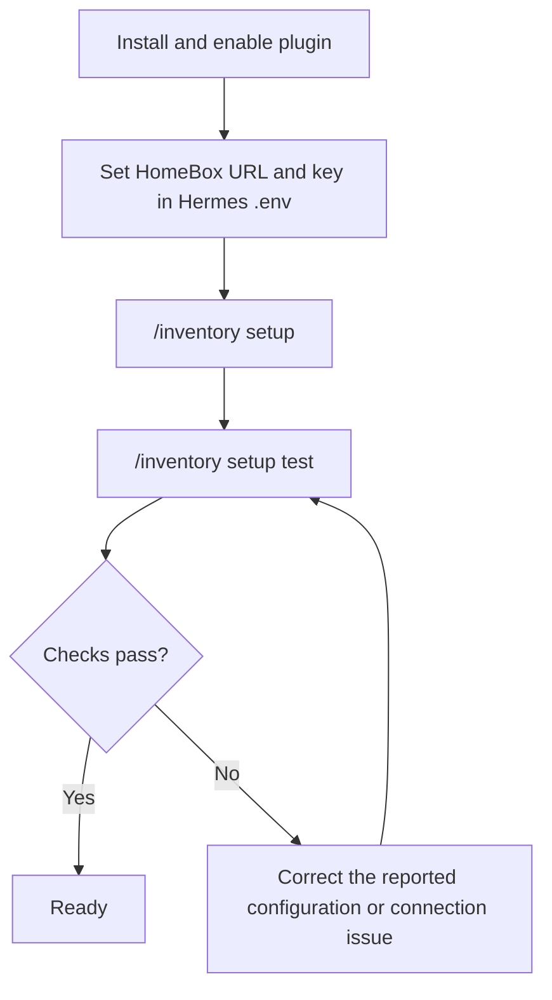
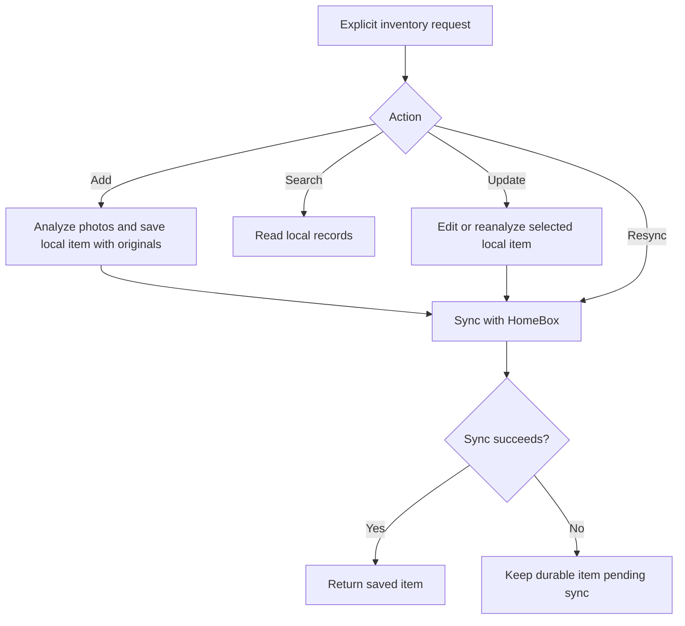
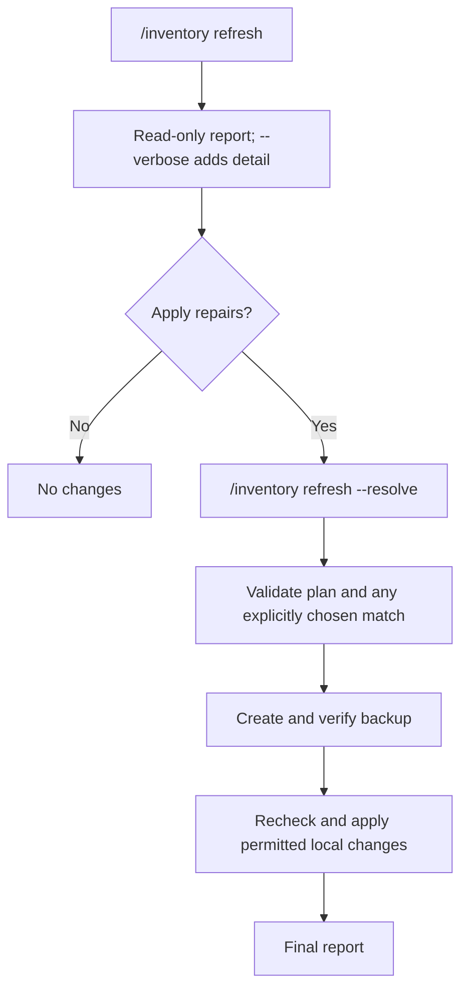
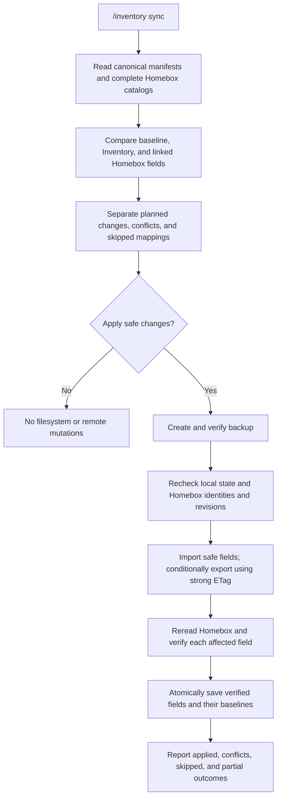

# Inventory Workflows

An optional visual overview of current behavior. For installation, credentials, paths, and commands, use the [README](../README.md). Future work belongs in the [POAM](POAM.md).

## Setup

Configure HomeBox in Hermes' existing `.env`; interactive secret setup is optional. Credentials never belong in chat.

## Add, Search, and Update

Attach photos and ask to add the item in the same message. Only those attachments are processed; there is no background watcher or upload queue. Local records and originals are durable; user edits survive reanalysis and search never changes records.

## Reconcile

Refresh compares local, legacy, and HomeBox records. Repairs require a verified backup; ambiguous matches require your explicit choice. Existing HomeBox items and legacy evidence are not deleted or overwritten.

Add `--dry-run` to a resolution command to preview without applying changes.

## Synchronize Linked Fields

Sync is separate from refresh. Use `/inventory sync` or `/inventory sync --item 000-011` to preview without writes. `/inventory sync --conflicts` shows both values, the last verified baseline when known, and their sources. Add `--resolve` to a preview command to apply only safe changes; it cannot be combined with `--conflicts`.

Missing baselines never authorize choosing a winner. Equal values can establish a baseline on resolve; differing values require deliberate reconciliation. Plugin-delimited generated notes are separate from Homebox user text; ambiguous legacy notes block notes synchronization. Remote exports are currently blocked because the full write contract and conditional enforcement remain unverified, even if a strong ETag is present. Verified imports and equal-field baseline establishment remain available. Setup diagnostics use GET only; no live write probe or force override is exposed. See the [README](../README.md#field-synchronization) for exact field mappings, baseline format, and compatibility limits.
